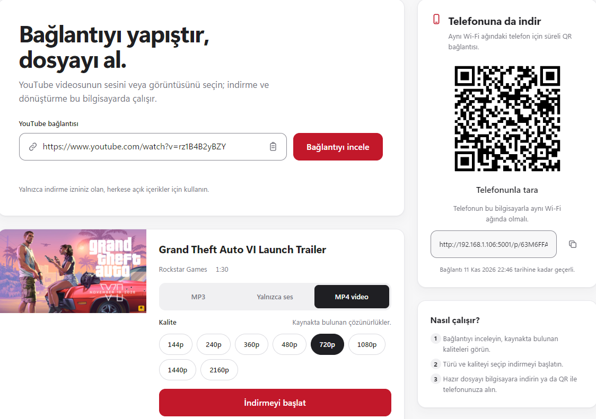

# TubeFlow

TubeFlow, herkese açık YouTube videolarını inceleyip indirme izniniz olan içerikleri bilgisayarınıza kaydetmenizi sağlayan, Windows'ta yerel çalışan bir Flask uygulamasıdır. Bağlantıyı yapıştırdıktan sonra video bilgilerini ve kaynakta bulunan formatları görür; ses veya video kalitesini seçerek indirmeyi başlatırsınız. İndirme, dönüştürme ve dosya geçmişi kendi bilgisayarınızda yönetilir.



## Özellikler

| Özellik | Açıklama |
| --- | --- |
| Bağlantı inceleme | YouTube video bağlantısını doğrular; başlık, kanal/yükleyici, süre, küçük resim ve kullanılabilir formatları gösterir. Oynatma listesi bağlantısı verilirse yalnızca ilk video incelenir. |
| Üç çıktı türü | MP3, dönüştürmesiz ses akışı veya MP4 video olarak indirme seçenekleri sunar. |
| Kalite seçimi | Videonun mevcut çözünürlüklerini ve ses akışlarının bit hızlarını gösterir; seçimler kaynakta sunulan formatlarla sınırlıdır. |
| İndirme takibi | Aşama, yüzde, indirilen/toplam boyut, hız ve tahmini kalan süreyi gösterir. |
| Yerel geçmiş | Son indirmeleri küçük resim, tür, kalite, dosya boyutu ve tarihle listeler; dosya hâlâ mevcutsa yeniden indirme olanağı verir. |
| Telefona aktarım | Hazır dosya için aynı Wi-Fi ağındaki telefondan açılabilen, süreli QR bağlantısı üretir. |
| Yerel çalışma | Ana arayüz yalnızca bu bilgisayardan erişilebilir. Medya dosyaları ve indirme geçmişi yerel diskte tutulur. |

### İndirme seçenekleri

| Tür | Çıktı | Kalite seçenekleri | Gereksinim |
| --- | --- | --- | --- |
| MP3 | YouTube ses akışından MP3 dosyası | 128, 192 veya 320 kbps | FFmpeg; ses dönüşümü yapılır. |
| Yalnızca ses | Kaynaktaki ses akışı | Videoda mevcut ses bit hızları | Dönüştürme yapılmadan uygun ses akışı indirilir. |
| MP4 video | Video ve ses içeren video dosyası | Kaynakta mevcut çözünürlükler | Ses ve görüntü akışlarını birleştirmek/remux etmek için FFmpeg gerekir. |

Mevcut seçenekler videoya göre değişir. Uygulama yalnızca tek video bağlantısını destekler; özel, üyelik veya oturum açma gerektiren içerikleri işlemez.

## Hangi veriler indirilir ve kaydedilir?

Bağlantıyı incelemek tek başına medya dosyası indirmez. İnceleme sırasında yt-dlp, YouTube'dan video bilgilerini ve mevcut formatları alır; indirme başlatıldığında yalnızca seçilen ses veya video çıktısı bilgisayarınıza indirilir. Uygulama, TubeFlow'a ait bir uzak sunucuya veri göndermez; YouTube'a erişmek için internet bağlantısı gerekir.

| Veri | Ne zaman / nerede kullanılır? | Yerel olarak saklanır mı? |
| --- | --- | --- |
| Video başlığı, kanal/yükleyici, süre ve küçük resim adresi | İnceleme sonucunda arayüzde ve geçmişte gösterilir. Küçük resim tarayıcıda YouTube'un adresinden yüklenir. | Tamamlanan indirmelerin geçmiş kaydında tutulur. |
| Video kimliği ve standartlaştırılmış YouTube bağlantısı | İstek sırasında videoyu tanımlamak ve indirmeyi başlatmak için kullanılır. | Tamamlanan indirme geçmişine kaynak bağlantısı olarak yazılmaz. |
| Kullanılabilir formatlar ve kalite bilgileri | İnceleme sırasında seçilebilir tür ve kaliteleri belirlemek için kullanılır. | Kalıcı geçmişe kaydedilmez. İnceleme sonucu uygulama belleğinde en fazla 30 dakika önbelleklenir. |
| Seçilen medya dosyası | İstenen MP3, ses veya video çıktısıdır. | `downloads/` altında, her iş için ayrı klasörde saklanır. |
| İndirme geçmişi | Tamamlanan indirmelerin listesini oluşturur. Başlık, küçük resim adresi, kanal, dosya adı, tür, kalite, boyut, süre ve tamamlanma zamanı gibi bilgileri içerir. | `data/history.json` dosyasına yazılır; varsayılan olarak en fazla 50 kayıt tutulur. |
| Telefon aktarım bağlantısı | QR ile dosyayı aynı yerel ağdaki telefona indirmek için kullanılır. | Token uygulama belleğinde tutulur, geçmiş dosyasına yazılmaz ve varsayılan olarak 24 saat sonra geçersiz olur. |

Başarısız indirme denemelerinin geçici dosyaları silinir. Tamamlanmış indirmeler ve ilgili geçmiş kayıtları varsayılan olarak yedi gün sonra, uygulama yeniden başlatıldığında temizlenir. Saklama süresi ve klasörler yapılandırılabilir.

## Kullanılan diller ve teknolojiler

- **Python** — uygulama sunucusu ve indirme işlemleri
- **HTML, CSS ve JavaScript** — web arayüzü
- **Flask, yt-dlp ve qrcode** — web sunucusu, medya işlemleri ve QR kodları
- **FFmpeg** — ses/video dönüştürme ve birleştirme

## Windows'ta başlatma

1. Python 3.10 veya üzeri sürümü kurun; Python başlatıcısının (`py`) kullanılabilir olduğundan emin olun.
2. `run.bat` dosyasına çift tıklayın. Masaüstünde TubeFlow için YouTube tarzı özel simgeli `TubeFlow - YouTube Baslat` kısayolunu oluşturur veya günceller. Gerekirse `.venv` sanal ortamını oluşturur, `requirements.txt` içindeki paketleri kurar ve uygulamayı başlatır. Sonraki açılışlarda masaüstü kısayolunu kullanabilirsiniz.
3. Tarayıcı kendiliğinden açılmazsa `http://127.0.0.1:5000` adresine gidin. Uygulamayı durdurmak için terminali kapatın veya Ctrl+C tuşlarına basın.

İlk başlatmada `run.bat`, FFmpeg'i kontrol eder. FFmpeg kurulu değilse ffmpeg.org'un işaret ettiği Windows derleme sağlayıcısı Gyan.dev'den gerekli ZIP dosyasını indirir, yayımlanan SHA-256 özetiyle doğrular ve çalıştırılabilir dosyaları `tools/ffmpeg/bin/` klasörüne kurar. Sistem PATH'i değiştirilmez ve yönetici izni gerekmez. İndirme veya doğrulama başarısız olsa da uygulama açılır; FFmpeg gerektiren özellikler kullanılamayabilir. Var olan FFmpeg konumunu `TUBEFLOW_FFMPEG` ortam değişkeniyle belirtebilirsiniz.

## Elle çalıştırma

```powershell
py -3 -m venv .venv
.venv\Scripts\python.exe -m pip install -r requirements.txt
.venv\Scripts\python.exe run.py
```

Ana arayüz yalnızca `127.0.0.1` adresinde çalışır. Telefona aktarım ayrı bir yerel ağ sunucusu ve tahmin edilemeyen, süresi dolan bir token kullanır; iki cihazın aynı Wi-Fi ağında olması gerekir. İnternete açık sunucu veya yönlendiricide port yönlendirme yapılandırılmaz. Yerel ağ aktarımı etkinleştirilirken güvenlik duvarı izni istenebilir.

## Yapılandırma

| Ortam değişkeni | Varsayılan | Açıklama |
| --- | --- | --- |
| `TUBEFLOW_PORT` | `5000` | Yalnızca yerel arayüzün portu. Doluysa uygulama sonraki uygun portu arar. |
| `TUBEFLOW_LAN_PORT` | `5001` | Telefon aktarım sunucusunun başlangıç portu. |
| `TUBEFLOW_LAN_IP` | Otomatik algılanır | Telefonun bağlanacağı özel IPv4 adresini elle belirler. |
| `TUBEFLOW_FFMPEG` | Otomatik algılanır | FFmpeg çalıştırılabilir dosyasının yolu veya bulunduğu klasör. |
| `TUBEFLOW_DOWNLOAD_DIR` | `downloads/` | İndirilen medya ve geçici iş klasörlerinin konumu. |
| `TUBEFLOW_DATA_DIR` | `data/` | `history.json` geçmiş dosyasının konumu. |
| `TUBEFLOW_TOKEN_TTL` | `86400` saniye | Telefon aktarım token'ının geçerlilik süresi (en az 300 saniye). |
| `TUBEFLOW_RETENTION_DAYS` | `7` | Tamamlanmış dosyaların ve geçmiş kayıtlarının saklanacağı gün sayısı. |
| `TUBEFLOW_MAX_HISTORY` | `50` | Geçmişte tutulacak en fazla kayıt sayısı. |
| `TUBEFLOW_MAX_CONCURRENT` | `2` | Aynı anda yürütülebilecek indirme sayısı. |
| `TUBEFLOW_NO_BROWSER` | Tanımsız | `1` olarak ayarlanırsa başlatırken tarayıcı otomatik açılmaz. |

## Kullanım notu

TubeFlow'u yalnızca indirme izniniz olan herkese açık içerikler için kullanın. Telif haklarına ve YouTube Kullanım Şartları'na uyun. Özel veya üyelik kısıtlamalı içeriklere erişme ya da erişim kontrollerini aşma iş akışları desteklenmez.

## Lisans

Bu proje MIT Lisansı ile lisanslanmıştır. Ayrıntılar için [LICENSE](LICENSE) dosyasına bakın.
